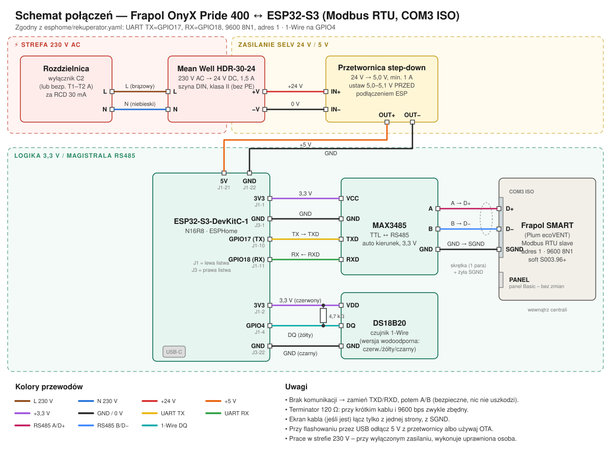

# Frapol OnyX Pride 400 → Home Assistant (ESPHome + Modbus RTU)

Sterowanie trybami i odczyt parametrów rekuperatora Frapol OnyX Pride 400
(sterownik Frapol SMART = Plum ecoVENT) przez Modbus RTU na porcie **COM3 ISO**.

## Sprzęt
- ESP32-S3 DevKitC-1 (N16R8)
- Moduł MAX3485 TTL↔RS485 (automatyczny kierunek, 3,3 V)
- Mean Well HDR-30-24 + przetwornica step-down 24 V → 5 V (min. 1 A)
- Czujnik DS18B20 + rezystor 4,7 kΩ
- Zabezpieczenie 230 V: C2 (lub T1A–T2A), obwód za RCD 30 mA

## Połączenia
| Od | Do |
|---|---|
| Przetwornica OUT+ / OUT− | ESP 5V / GND |
| ESP 3V3 / GND | MAX3485 VCC / GND |
| ESP GPIO17 | MAX3485 TXD |
| ESP GPIO18 | MAX3485 RXD |
| MAX3485 A / B / GND | COM3 ISO D+ / D− / SGND |
| ESP 3V3 / GPIO4 / GND | DS18B20 VDD / DQ / GND (4,7 kΩ DQ↔VDD) |

Panel Basic zostaje na zacisku PANEL bez zmian. Brak komunikacji → zamień TXD/RXD, potem A/B.

## Konfiguracja sterownika
Menu instalatora → Ustawienia Modbus: Aktywowanie = Tak, Edycja parametrów = Tak,
Sterowanie rekuperatorem = Tak, adres 1, 9600 bps, 8N1. Wymagany soft S003.96+ (sprawdź w Informacje).

## Uwagi
- Mapa rejestrów pochodzi z tabeli Modbus Plum ecoVENT MIDI (S003.08+) — **zweryfikuj odczyty z panelem przed zapisem**.
- Skala temperatur (×0,1 lub ×1) do potwierdzenia.
- Nie zmieniaj trybów zbyt często z automatyzacji (zapis do pamięci sterownika).

Konfiguracja: [`esphome/rekuperator.yaml`](esphome/rekuperator.yaml) · Schemat: [`docs/schemat.svg`](docs/schemat.svg)
